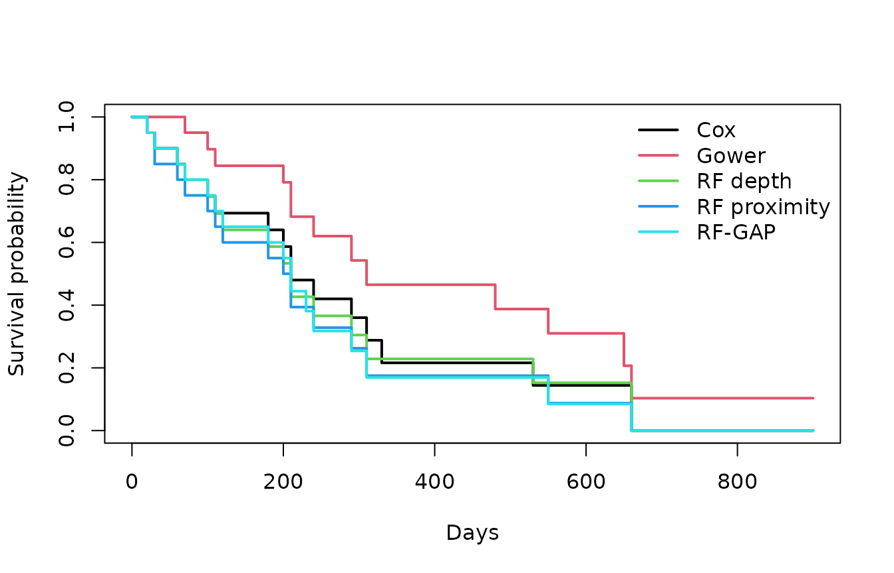

# Comparing the Approaches

The
[Methods](https://sipemu.github.io/case-based-reasoning/articles/distance_measures.md)
vignette defines the distances of this package. Here we apply all of
them to the same problem and look at the differences in practice: which
cases they retrieve, why, how well the retrieved cases predict, and how
the distances react to irrelevant features and to changes in the data.

## Data and models

We use the survival of 213 patients with advanced lung cancer
([`survival::lung`](https://rdrr.io/pkg/survival/man/lung.html)). The
features are age, sex, two performance scores (ECOG, 0 = fully active,
and Karnofsky, 100 = no complaints) and the weight loss in the last six
months. 160 patients form the case base, the other 53 are new patients
(queries).

``` r

lung2 <- na.omit(lung[, c("time", "status", "age", "sex", "ph.ecog", "ph.karno", "wt.loss")])
lung2$status <- lung2$status - 1
lung2$sex <- factor(lung2$sex, labels = c("male", "female"))
features <- c("age", "sex", "ph.ecog", "ph.karno", "wt.loss")

set.seed(2024)
idx <- sample(nrow(lung2), 160)
train <- lung2[idx, ]
test <- lung2[-idx, ]
```

We build five distances. The Cox model gets a spline for age, the forest
and the Gower distance use the features as they are.

``` r

fml <- Surv(time, status) ~ age + sex + ph.ecog + ph.karno + wt.loss
fit_all <- function(train, seed = 1) {
  cox <- CoxModel$new(Surv(time, status) ~ rcs(age, 3) + sex + ph.ecog + ph.karno + wt.loss, train)
  cox$fit()
  gower <- GowerModel$new(fml, train)
  gower$fit()
  set.seed(seed)
  rf <- RFModel$new(fml, train, num.trees = 300)
  rf$fit()
  # three distances from the same forest
  rf_prox <- rf$clone()$set_distance_method("Proximity")
  rf_gap <- rf$clone()$set_distance_method("Proximity", proximity_type = "rfgap")
  list("Cox" = cox, "Gower" = gower, "RF depth" = rf,
       "RF proximity" = rf_prox, "RF-GAP" = rf_gap)
}
models <- fit_all(train)
```

## Which cases are retrieved?

Take the first new patient:

``` r

query <- test[1, ]
knitr::kable(query)
```

|     | time | status | age | sex    | ph.ecog | ph.karno | wt.loss |
|:----|-----:|-------:|----:|:-------|--------:|---------:|--------:|
| 8   |  361 |      1 |  71 | female |       2 |       60 |       1 |

The five most similar cases for each distance:

``` r

neighbours <- function(model, query, k) {
  d <- model$calc_distance_matrix(query)
  apply(d, 2, order)[seq_len(k), , drop = FALSE]
}
show <- lapply(names(models), function(m) {
  nn <- neighbours(models[[m]], query, k = 5)[, 1]
  cbind(method = m, train[nn, c(features, "time", "status")])
})
knitr::kable(do.call(rbind, show), row.names = FALSE)
```

| method       | age | sex    | ph.ecog | ph.karno | wt.loss | time | status |
|:-------------|----:|:-------|--------:|---------:|--------:|-----:|-------:|
| Cox          |  70 | female |       2 |       70 |       3 |  211 |      0 |
| Cox          |  76 | female |       2 |       60 |     -24 |   95 |      1 |
| Cox          |  50 | female |       2 |       60 |      -3 |  239 |      1 |
| Cox          |  67 | female |       2 |       70 |       2 |  208 |      1 |
| Cox          |  68 | female |       2 |       70 |      10 |  310 |      1 |
| Gower        |  70 | female |       2 |       70 |       3 |  211 |      0 |
| Gower        |  67 | female |       2 |       70 |       2 |  208 |      1 |
| Gower        |  68 | female |       2 |       70 |      10 |  310 |      1 |
| Gower        |  76 | female |       2 |       60 |     -24 |   95 |      1 |
| Gower        |  72 | female |       2 |       70 |      20 |  285 |      1 |
| RF depth     |  70 | female |       2 |       70 |       3 |  211 |      0 |
| RF depth     |  67 | female |       2 |       70 |       2 |  208 |      1 |
| RF depth     |  68 | female |       2 |       70 |      10 |  310 |      1 |
| RF depth     |  50 | female |       2 |       60 |      -3 |  239 |      1 |
| RF depth     |  72 | female |       2 |       70 |      20 |  285 |      1 |
| RF proximity |  70 | female |       2 |       70 |       3 |  211 |      0 |
| RF proximity |  67 | female |       2 |       70 |       2 |  208 |      1 |
| RF proximity |  68 | female |       2 |       70 |      10 |  310 |      1 |
| RF proximity |  50 | female |       2 |       60 |      -3 |  239 |      1 |
| RF proximity |  76 | female |       2 |       60 |     -24 |   95 |      1 |
| RF-GAP       |  70 | female |       2 |       70 |       3 |  211 |      0 |
| RF-GAP       |  67 | female |       2 |       70 |       2 |  208 |      1 |
| RF-GAP       |  68 | female |       2 |       70 |      10 |  310 |      1 |
| RF-GAP       |  70 | male   |       3 |       60 |      20 |  118 |      1 |
| RF-GAP       |  50 | female |       2 |       60 |      -3 |  239 |      1 |

For this patient, all distances find women with the same ECOG score and
a similar age; the nearest case is the same for all of them. Further
down the lists, they disagree.

How similar are the neighbourhoods in general? For every new patient we
take the 10 nearest cases of each distance and compute the overlap of
two neighbourhoods, $`|A \cap B| / |A \cup B|`$ (Jaccard), averaged over
the new patients:

``` r

k <- 10
nn_all <- lapply(models, neighbours, query = test, k = k)
jaccard <- function(a, b) mean(vapply(seq_len(ncol(a)), function(q) {
  length(intersect(a[, q], b[, q])) / length(union(a[, q], b[, q]))
}, numeric(1)))
overlap <- outer(names(nn_all), names(nn_all),
                 Vectorize(function(a, b) jaccard(nn_all[[a]], nn_all[[b]])))
dimnames(overlap) <- list(names(nn_all), names(nn_all))
knitr::kable(overlap, digits = 2)
```

|              |  Cox | Gower | RF depth | RF proximity | RF-GAP |
|:-------------|-----:|------:|---------:|-------------:|-------:|
| Cox          | 1.00 |  0.70 |     0.42 |         0.38 |   0.34 |
| Gower        | 0.70 |  1.00 |     0.48 |         0.44 |   0.41 |
| RF depth     | 0.42 |  0.48 |     1.00 |         0.71 |   0.65 |
| RF proximity | 0.38 |  0.44 |     0.71 |         1.00 |   0.82 |
| RF-GAP       | 0.34 |  0.41 |     0.65 |         0.82 |   1.00 |

There are two families. The Cox and the Gower distance, both sums of
per-feature differences, share most of their neighbours; the three
forest distances share most of theirs. Between the families, only about
four in ten neighbours are the same. **The choice of the distance
changes the retrieved cases considerably**, even when, as we will see,
it hardly changes the quality of the predictions.

## Why are cases similar?

`explain_match()` explains a match for every distance, but each in its
own terms: the Cox model in contributions to the log hazard, the Gower
distance in per-feature differences, the forest in split variables at
which the paths of the cases diverge.

``` r

nn1 <- function(m) train[nn_all[[m]][1, 1], ]
knitr::kable(models$Cox$explain_match(query, nn1("Cox")), digits = 3)
```

| term        | query_contribution | case_contribution | distance | share |
|:------------|-------------------:|------------------:|---------:|------:|
| ph.karno    |              1.358 |             1.584 |    0.226 | 0.842 |
| rcs(age, 3) |              0.491 |             0.461 |    0.030 | 0.113 |
| wt.loss     |             -0.006 |            -0.018 |    0.012 | 0.045 |
| sex         |             -0.612 |            -0.612 |    0.000 | 0.000 |
| ph.ecog     |              1.858 |             1.858 |    0.000 | 0.000 |

``` r

knitr::kable(models$Gower$explain_match(query, nn1("Gower")), digits = 3)
```

| variable | query_value | case_value | weight | distance | share |
|:---------|:------------|:-----------|-------:|---------:|------:|
| ph.karno | 60          | 70         |      1 |    0.040 | 0.816 |
| age      | 71          | 70         |      1 |    0.005 | 0.095 |
| wt.loss  | 1           | 3          |      1 |    0.004 | 0.089 |
| sex      | female      | female     |      1 |    0.000 | 0.000 |
| ph.ecog  | 2           | 2          |      1 |    0.000 | 0.000 |

``` r

knitr::kable(models$`RF depth`$explain_match(query, nn1("RF depth")), digits = 3)
```

| variable | n_trees | share |
|:---------|--------:|------:|
| ph.karno |      57 | 0.518 |
| wt.loss  |      45 | 0.409 |
| age      |       8 | 0.073 |
| sex      |       0 | 0.000 |
| ph.ecog  |       0 | 0.000 |

The nearest case agrees with the query in sex and ECOG, so all three
explanations attribute the remaining distance to the Karnofsky score,
age and weight loss, each in its own terms.

What does each distance pay attention to in general? We change one
feature of a case from its lower to its upper quartile (for sex: from
male to female), keep the other features, and measure the distance
between the two versions. Relative to the sum over the features, this is
the weight each distance gives to a typical difference in a feature:

``` r

iqr_change <- function(data, f, lower) {
  v <- data[[f]]
  data[[f]] <- if (is.factor(v)) {
    factor(levels(v)[if (lower) 1 else 2], levels(v))
  } else {
    unname(quantile(v, if (lower) 0.25 else 0.75, type = 1))
  }
  data
}
feature_weights <- function(models, data, features) {
  rf <- models$`RF depth`$model_fit
  w <- sapply(features, function(f) {
    lo <- iqr_change(data, f, TRUE)
    hi <- iqr_change(data, f, FALSE)
    c("Cox"      = sum(models$Cox$explain_match(lo[1, ], hi[1, ])$distance),
      "Gower"    = sum(models$Gower$explain_match(lo[1, ], hi[1, ])$distance),
      # the forest distance depends on the other features: average over all cases
      "RF depth" = mean(diag(depth_distance(lo[, features], hi[, features], rf))) / rf$num.trees)
  })
  w / rowSums(w)
}
knitr::kable(feature_weights(models, train, features), digits = 2)
```

|          |  age | sex | ph.ecog | ph.karno | wt.loss |
|:---------|-----:|----:|--------:|---------:|--------:|
| Cox      | 0.10 | 0.3 |    0.45 |     0.11 |    0.05 |
| Gower    | 0.14 | 0.5 |    0.17 |     0.10 |    0.09 |
| RF depth | 0.27 | 0.2 |    0.17 |     0.13 |    0.23 |

The three distances weight the features very differently:

- The **Cox distance** follows the estimated effects: ECOG and sex, the
  strongest prognostic factors in these data, dominate.
- The **Gower distance** follows the scale of the features: sex is
  binary, so male vs. female is the largest possible difference (1); a
  typical difference in age or weight loss is a small part of the range.
- The **forest** spreads its weight more evenly and gives the continuous
  features (age, weight loss) the most weight. Trees split more often on
  features with many possible split points (Strobl et al., 2007), and
  every split adds edges to the depth distance.

## How well do the retrieved cases predict?

Each distance predicts the survival curve of a new patient by the
Kaplan–Meier estimate of the 20 nearest cases. For the first patient:

``` r

times <- seq(0, 900, by = 10)
curves <- sapply(models, function(m) m$predict_survival(query, k = 20, times = times)[1, ])
matplot(times, curves, type = "s", lty = 1, lwd = 2, col = 1:5,
        xlab = "Days", ylab = "Survival probability", ylim = c(0, 1))
legend("topright", names(models), col = 1:5, lty = 1, lwd = 2, bty = "n")
```



On all new patients, scored with Uno’s C-index (higher is better) and
the integrated Brier score (IBS, lower is better):

``` r

scores <- t(sapply(models, function(m) {
  ev <- m$evaluate_survival(test, k = 20)
  c(c_index = ev$c_index, ibs = ev$ibs)
}))
knitr::kable(scores, digits = 3)
```

|              | c_index |   ibs |
|:-------------|--------:|------:|
| Cox          |   0.608 | 0.207 |
| Gower        |   0.610 | 0.195 |
| RF depth     |   0.604 | 0.213 |
| RF proximity |   0.620 | 0.213 |
| RF-GAP       |   0.578 | 0.217 |

The differences are small, as in the [benchmark
article](https://sipemu.github.io/case-based-reasoning/articles/benchmark.html),
and with 53 test patients well within the noise. Predictive performance
is rarely the reason to prefer one distance; their behaviour and
interpretation are.

## Irrelevant features

In practice, not every feature in the data is relevant. We add five
features of pure noise and refit all models.

``` r

add_noise <- function(df) {
  noise <- as.data.frame(matrix(rnorm(nrow(df) * 5), ncol = 5,
                                dimnames = list(NULL, paste0("noise", 1:5))))
  cbind(df, noise)
}
set.seed(7)
train_n <- add_noise(train)
test_n <- add_noise(test)
fml_n <- update(fml, ~ . + noise1 + noise2 + noise3 + noise4 + noise5)

cox_n <- CoxModel$new(update(Surv(time, status) ~ rcs(age, 3) + sex + ph.ecog + ph.karno + wt.loss,
                             ~ . + noise1 + noise2 + noise3 + noise4 + noise5), train_n)
cox_n$fit()
gower_n <- GowerModel$new(fml_n, train_n)
gower_n$fit()
set.seed(1)
rf_n <- RFModel$new(fml_n, train_n, num.trees = 300)
rf_n$fit()
models_n <- list("Cox" = cox_n, "Gower" = gower_n, "RF depth" = rf_n)
```

How much weight do the noise features get, how much do the
neighbourhoods change, and how do the predictions change?

``` r

w_noise <- feature_weights(models_n, train_n, c(features, paste0("noise", 1:5)))
noise_tbl <- data.frame(
  method = names(models_n),
  noise_weight = rowSums(w_noise[, paste0("noise", 1:5)]),
  overlap_with_clean = vapply(names(models_n), function(m) {
    jaccard(nn_all[[m]], neighbours(models_n[[m]], test_n, k = k))
  }, numeric(1)),
  c_index = vapply(models_n, function(m) m$evaluate_survival(test_n, k = 20)$c_index, numeric(1)),
  c_index_clean = scores[names(models_n), "c_index"]
)
knitr::kable(noise_tbl, digits = 2, row.names = FALSE)
```

| method   | noise_weight | overlap_with_clean | c_index | c_index_clean |
|:---------|-------------:|-------------------:|--------:|--------------:|
| Cox      |         0.26 |               0.51 |    0.54 |          0.61 |
| Gower    |         0.41 |               0.37 |    0.56 |          0.61 |
| RF depth |         0.58 |               0.31 |    0.58 |          0.60 |

- The **Cox model** estimates small, but not zero, coefficients for the
  noise features: with 160 cases, chance associations remain. About a
  quarter of its distance is noise.
- The **Gower distance** weights the noise like the real features: it
  gets the share that five of ten features get by their scale.
- The **forest** gives the noise the most weight: on a small data set,
  the trees find many splits in continuous noise that look useful.
  Larger leaves (`min.node.size`) do not change this much. Its
  neighbourhoods change the most.

All distances predict worse with noise. The C-index on 53 test patients
is too noisy to rank the distances; the weights and overlaps show the
mechanism. On larger data sets the coefficients of the noise features
shrink towards zero, and the regression distance loses its noise; see
the benchmark article for the Pima data with 532 cases. With many
candidate features, select the features before building the distance
(e.g. with `CoxModel$variable_selection()`).

## Stability

A distance learned from data changes when the data change. We refit each
distance on five random subsamples of 90% of the case base and check how
stable the 10 nearest cases of the new patients are (overlap of the
neighbourhoods of two subsamples, restricted to cases in both).

``` r

set.seed(3)
subsamples <- replicate(5, sort(sample(nrow(train), 144)), simplify = FALSE)
nn_sub <- lapply(seq_along(subsamples), function(s) {
  tr <- train[subsamples[[s]], ]
  ms <- fit_all(tr, seed = s)
  lapply(ms, function(m) {
    nn <- neighbours(m, test, k = nrow(tr))
    matrix(rownames(tr)[nn], nrow = nrow(tr))
  })
})
common <- Reduce(intersect, lapply(subsamples, function(s) rownames(train)[s]))
top_common <- function(nn) apply(nn, 2, function(x) x[x %in% common][seq_len(k)])
stability <- vapply(names(models), function(m) {
  tops <- lapply(nn_sub, function(x) top_common(x[[m]]))
  pairs <- combn(length(tops), 2)
  mean(apply(pairs, 2, function(p) jaccard(tops[[p[1]]], tops[[p[2]]])))
}, numeric(1))
knitr::kable(data.frame(method = names(stability), stability = stability),
             digits = 2, row.names = FALSE)
```

| method       | stability |
|:-------------|----------:|
| Cox          |      0.72 |
| Gower        |      0.98 |
| RF depth     |      0.75 |
| RF proximity |      0.78 |
| RF-GAP       |      0.74 |

The Gower distance changes only through the ranges of the features and
is the most stable. The Cox distance changes with the estimated
coefficients; the forest distances change with the forest, and also with
the random seed.

## Summary

|  | Cox (regression) | Random forest | Gower |
|----|----|----|----|
| Weights the features by | estimated effects | number of splits (favours continuous features) | scale (favours binary features) |
| Explanation | contribution to the log hazard per term | split variables where the paths diverge | difference per feature |
| Irrelevant features | small weight, shrinking with more cases | substantial weight on small data | full weight |
| Stability | changes with the coefficients | changes with the forest and the seed | very stable |
| Assumptions | proportional hazards, specified functional form | few | none |
| Prediction (here) | similar | similar | similar |

- Use the **regression distance** when the model fits well and the
  retrieved cases must be justified: every distance can be traced to
  effects on the outcome.
- Use the **forest distances** when the relationships are complex or
  unknown; RF-GAP when the neighbours should explain the forest’s
  prediction, the depth distance for a finer ranking.
- Use the **Gower distance** as a baseline and when all features are
  known to be relevant; it does not need an outcome model.
- Check the choice on held-out data (`evaluate()`,
  `evaluate_survival()`) and look at the retrieved cases: distances that
  predict equally well can retrieve very different cases.

## References

- Strobl, C., Boulesteix, A.-L., Zeileis, A. and Hothorn, T. (2007).
  [Bias in random forest variable importance measures: Illustrations,
  sources and a solution](https://doi.org/10.1186/1471-2105-8-25). *BMC
  Bioinformatics*, 8, 25.
