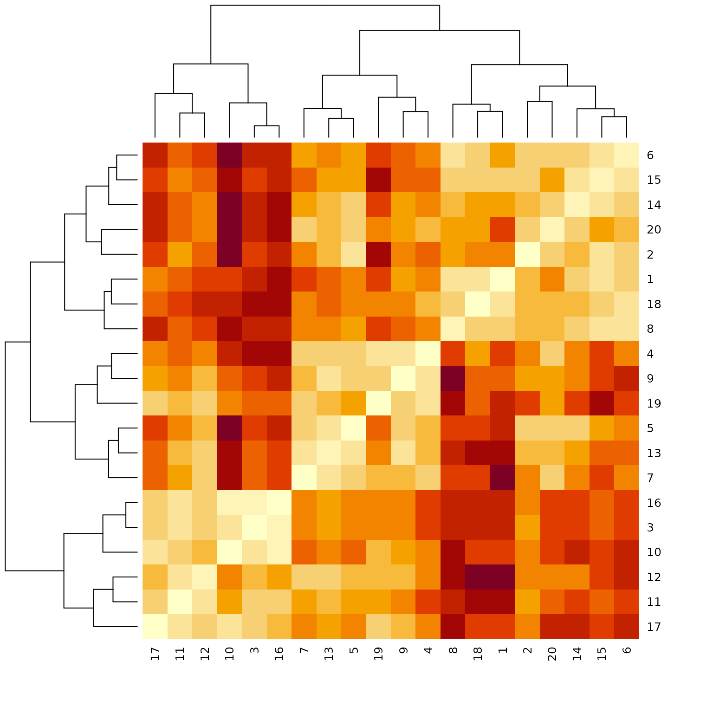

# Get Started

## Motivation

Case-Based Reasoning (CBR) solves new problems by finding similar past
cases. This package uses regression models—Cox Proportional Hazards
(CPH), linear, and logistic—and random forests to define a principled
distance between cases: two cases are close if the fitted model
considers them alike. The workflow is: prepare data, fit a model, then
query for similar cases. The retrieved cases can then be used to predict
outcomes and survival, to find counterfactual cases and to explain
matches.

This vignette is a hands-on tour, following the steps of the CBR cycle:

| Step | What it does | Functions |
|----|----|----|
| Retrieve | find the most similar cases | `get_similar_cases()`, `calc_distance_matrix()`, `explain_match()` |
| Reuse | predict from the retrieved cases | `predict_outcome()`, `predict_survival()`, `get_counterfactual_cases()` |
| Revise | evaluate the predictions | `evaluate()`, `evaluate_survival()`, `check_ph()` |
| Retain | maintain the case base | `add_cases()`, `remove_cases()`, `assess_cases()` |

The
[Methods](https://sipemu.github.io/case-based-reasoning/articles/distance_measures.md)
vignette explains the mathematics behind each step, with worked examples
and the advantages and disadvantages of each distance. [Comparing the
Approaches](https://sipemu.github.io/case-based-reasoning/articles/comparing_approaches.md)
applies all distances to the same data.

## Cox Proportional Hazard Model

We demonstrate the CPH model using the `ovarian` dataset from the
**survival** package.

``` r

ovarian$resid.ds <- factor(ovarian$resid.ds)
ovarian$rx <- factor(ovarian$rx)
ovarian$ecog.ps <- factor(ovarian$ecog.ps)

# initialize R6 object
cph_model <- CoxModel$new(Surv(futime, fustat) ~ age + resid.ds + rx + ecog.ps, ovarian)
```

When the model is fitted, training cases with missing values are dropped
(with a warning) and character variables are converted to factors.
Factor levels of later queries are matched to the training data by name.

## Available Models

The package provides four model classes for estimating case similarity:

### **Linear Regression**

- Simple, fast, and interpretable via coefficients.
- Limited to continuous dependent variables.
- All regression models accept any rms term, e.g. splines
  (`rcs(age, 4)`) and interactions.

### **Logistic Regression**

- Suited for binary outcomes (e.g., success/failure).
- Assumes a linear relationship on the logit scale.

### **Cox Proportional Hazards Regression**

- Designed for time-to-event (survival) data with right-censoring.
- Assumes constant hazard ratios over time.

### **Gower Distance**

- Model-free distance for mixed data (`GowerModel`), optionally
  weighted.
- A baseline for the model-derived distances; all variables count
  equally unless weighted.

### **Random Forests**

- Captures non-linear relationships and feature interactions without
  specifying them.
- More computationally expensive and less interpretable than regression
  models; the distance depends on the random seed.

## Case Based Reasoning

### Search for Similar Cases

We split the data into training and query sets, then retrieve the most
similar training cases for each query case.

``` r

set.seed(42)
n <- nrow(ovarian)
trainID <- sample(1:n, floor(0.8 * n), FALSE)
testID <- (1:n)[-trainID]

cph_model <- CoxModel$new(Surv(futime, fustat) ~ age + resid.ds + rx + ecog.ps, ovarian[trainID, ])

# fit model 
cph_model$fit()

# get similar cases
matched_data_tbl <- cph_model$get_similar_cases(query = ovarian[testID, ], k = 3)
knitr::kable(head(matched_data_tbl))
```

|     | futime | fustat |     age | resid.ds | rx  | ecog.ps |    scDist | caseId |
|:----|-------:|-------:|--------:|:---------|:----|:--------|----------:|-------:|
| 10  |    563 |      1 | 55.1781 | 1        | 2   | 2       | 0.7533753 |      1 |
| 7   |    464 |      1 | 56.9370 | 2        | 2   | 2       | 1.1760552 |      2 |
| 24  |    353 |      1 | 63.2192 | 1        | 2   | 2       | 1.4624169 |      3 |
| 71  |    464 |      1 | 56.9370 | 2        | 2   | 2       | 0.3736327 |      1 |
| 241 |    353 |      1 | 63.2192 | 1        | 2   | 2       | 0.9489132 |      2 |
| 14  |    770 |      0 | 57.0521 | 2        | 2   | 1       | 1.0646258 |      3 |

**Note 1:** Training cases with missing values are dropped when the
model is fitted, and missing values in a query are an error. Perform a
missing value analysis beforehand.

**Note 2:** The data.frame returned from
**`cph_model$get_similar_cases`** contains k matched training cases per
query, with two additional columns:

1.  `scDist`: The distance between the query and the matched case.
2.  `caseId`: Rank of the match for its query (1 = most similar).

With `merge = TRUE`, the query cases are included too, identified by two
more columns:

3.  `scCaseId`: Number of the query case; a query and its matches share
    the same value.
4.  `group`: `"Query"` or `"Matched"`.

``` r

merged_tbl <- cph_model$get_similar_cases(query = ovarian[testID[1:2], ], k = 2, merge = TRUE)
knitr::kable(merged_tbl)
```

|     | futime | fustat |     age | resid.ds | rx  | ecog.ps |    scDist | caseId | scCaseId | group   |
|:----|-------:|-------:|--------:|:---------|:----|:--------|----------:|-------:|---------:|:--------|
| 6   |    448 |      0 | 56.4301 | 1        | 1   | 2       | 0.0000000 |      0 |        1 | Query   |
| 10  |    563 |      1 | 55.1781 | 1        | 2   | 2       | 0.7533753 |      1 |        1 | Matched |
| 7   |    464 |      1 | 56.9370 | 2        | 2   | 2       | 1.1760552 |      2 |        1 | Matched |
| 8   |    475 |      1 | 59.8548 | 2        | 2   | 2       | 0.0000000 |      0 |        2 | Query   |
| 71  |    464 |      1 | 56.9370 | 2        | 2   | 2       | 0.3736327 |      1 |        2 | Matched |
| 24  |    353 |      1 | 63.2192 | 1        | 2   | 2       | 0.9489132 |      2 |        2 | Matched |

For in-sample queries, `exclude_self = TRUE` keeps a training case from
being returned as its own nearest neighbour.

### Check Proportional Hazard Assumption

Verify that the proportional hazards assumption holds for the fitted
model:

``` r

cph_model$check_ph()
```


## Distance Matrix Calculation

You can also compute and visualize the full distance matrix:

``` r

distance_matrix <- cph_model$calc_distance_matrix()
heatmap(distance_matrix)
```



**`cph_model$calc_distance_matrix()`** computes the distance matrix
between the train and test data. If test data is omitted, it calculates
distances within the training data. Rows correspond to training
observations and columns to test observations. The result is also stored
internally as **`cph_model$dist_matrix`**.

## Survival Prediction

The retrieved cases can also predict the outcome of a query. For
survival endpoints, `predict_survival()` estimates a Kaplan–Meier curve
from each query’s `k` nearest training cases (Lowsky et al., 2013). We
use the larger `lung` data set and model age with a restricted cubic
spline.

``` r

lung_df <- na.omit(lung[, c("time", "status", "age", "sex", "ph.ecog", "wt.loss")])
lung_df$status <- lung_df$status - 1
lung_df$sex <- factor(lung_df$sex, labels = c("male", "female"))

set.seed(1)
train <- sample(nrow(lung_df), 150)
lung_train <- lung_df[train, ]
lung_test <- lung_df[-train, ]

lung_model <- CoxModel$new(Surv(time, status) ~ rcs(age, 3) + sex + ph.ecog + wt.loss, lung_train)
lung_model$fit()

# survival probabilities after 6 months, 1 and 2 years
surv <- lung_model$predict_survival(lung_test[1:5, ], k = 30, times = c(182, 365, 730))
knitr::kable(surv, digits = 2)
```

|  182 |  365 |  730 |
|-----:|-----:|-----:|
| 0.57 | 0.45 | 0.06 |
| 0.83 | 0.50 | 0.16 |
| 0.56 | 0.33 | 0.07 |
| 0.79 | 0.45 | 0.16 |
| 0.57 | 0.44 | 0.06 |

`evaluate_survival()` scores these predictions on held-out data with
Uno’s C-index (higher is better) and the integrated Brier score (IBS,
lower is better). This is a natural way to choose `k`:

``` r

scores <- sapply(c(10, 30, 60), function(k) {
  ev <- lung_model$evaluate_survival(lung_test, k = k)
  c(k = k, c_index = ev$c_index, ibs = ev$ibs)
})
knitr::kable(t(scores), digits = 3)
```

|   k | c_index |   ibs |
|----:|--------:|------:|
|  10 |   0.645 | 0.193 |
|  30 |   0.603 | 0.191 |
|  60 |   0.631 | 0.184 |

With `weighted = TRUE`, closer cases get larger weights (tricube
kernel).

## Counterfactual Cases and Explanations

A similar case with a *different* outcome shows what distinguishes the
query from cases that fared otherwise (Keane & Smyth, 2020). For
survival endpoints, the outcome is the event status at `horizon`; if the
query’s outcome is unknown, it is predicted from its most similar cases.

``` r

query <- lung_test[1, ]
cf <- lung_model$get_counterfactual_cases(query, k = 2, horizon = 365)
knitr::kable(cf, digits = 3)
```

|     | time | status | age | sex  | ph.ecog | wt.loss | scDist | caseId | queryOutcome |
|:----|-----:|-------:|----:|:-----|--------:|--------:|-------:|-------:|:-------------|
| 55  |  689 |      1 |  59 | male |       1 |      15 |  0.044 |      1 | event        |
| 48  |  519 |      1 |  63 | male |       1 |      10 |  0.054 |      2 | event        |

`explain_match()` breaks the distance between two cases down by model
term: each term’s contribution to the linear predictor for both cases,
the absolute difference, and its share of the total distance.

``` r

knitr::kable(lung_model$explain_match(query, cf[1, ]), digits = 3)
```

| term        | query_contribution | case_contribution | distance | share |
|:------------|-------------------:|------------------:|---------:|------:|
| wt.loss     |             -0.113 |            -0.154 |    0.041 | 0.936 |
| rcs(age, 3) |             -0.463 |            -0.460 |    0.003 | 0.064 |
| sex         |              0.000 |             0.000 |    0.000 | 0.000 |
| ph.ecog     |              0.479 |             0.479 |    0.000 | 0.000 |

## Random Forests

`RFModel` derives the distance from a random forest fitted with
**ranger**. The default is the depth distance (number of edges between
the cases’ terminal nodes, summed over trees); `set_distance_method()`
switches to the proximity distance, optionally with out-of-bag or RF-GAP
proximities (Rhodes, Cutler & Moon, 2023).

``` r

set.seed(1)
rf_model <- RFModel$new(Species ~ ., data = iris, num.trees = 200)
rf_model$fit()
knitr::kable(rf_model$get_similar_cases(iris[c(1, 51, 101), ], k = 2), digits = 3)
```

|     | Sepal.Length | Sepal.Width | Petal.Length | Petal.Width | Species    | scDist | caseId |
|:----|-------------:|------------:|-------------:|------------:|:-----------|-------:|-------:|
| 1   |          5.1 |         3.5 |          1.4 |         0.2 | setosa     |  0.000 |      1 |
| 3   |          4.7 |         3.2 |          1.3 |         0.2 | setosa     |  0.000 |      2 |
| 51  |          7.0 |         3.2 |          4.7 |         1.4 | versicolor |  0.000 |      1 |
| 66  |          6.7 |         3.1 |          4.4 |         1.4 | versicolor |  0.215 |      2 |
| 101 |          6.3 |         3.3 |          6.0 |         2.5 | virginica  |  0.000 |      1 |
| 137 |          6.3 |         3.4 |          5.6 |         2.4 | virginica  |  0.000 |      2 |

``` r

rf_model$set_distance_method("Proximity", proximity_type = "rfgap")
knitr::kable(rf_model$get_similar_cases(iris[c(1, 51, 101), ], k = 2), digits = 3)
```

|     | Sepal.Length | Sepal.Width | Petal.Length | Petal.Width | Species    | scDist | caseId |
|:----|-------------:|------------:|-------------:|------------:|:-----------|-------:|-------:|
| 3   |          4.7 |         3.2 |          1.3 |         0.2 | setosa     |  0.988 |      1 |
| 5   |          5.0 |         3.6 |          1.4 |         0.2 | setosa     |  0.989 |      2 |
| 51  |          7.0 |         3.2 |          4.7 |         1.4 | versicolor |  0.977 |      1 |
| 87  |          6.7 |         3.1 |          4.7 |         1.5 | versicolor |  0.980 |      2 |
| 145 |          6.7 |         3.3 |          5.7 |         2.5 | virginica  |  0.983 |      1 |
| 101 |          6.3 |         3.3 |          6.0 |         2.5 | virginica  |  0.985 |      2 |

RF-GAP proximities sum to one over the training cases, so RF-GAP
distances lie close to 1; only their order matters for retrieval.

For forests, `explain_match()` lists the split variables at which the
two cases’ paths diverge, counted over trees:

``` r

knitr::kable(rf_model$explain_match(iris[51, ], iris[60, ]), digits = 3)
```

| variable     | n_trees | share |
|:-------------|--------:|------:|
| Sepal.Length |      69 | 0.885 |
| Petal.Length |       5 | 0.064 |
| Sepal.Width  |       4 | 0.051 |
| Petal.Width  |       0 | 0.000 |

## Predicting Outcomes

For class and numeric endpoints, `predict_outcome()` predicts from the
`k` most similar cases: a majority vote with class probabilities, or a
mean (optionally tricube-weighted with `weighted = TRUE`). `evaluate()`
scores the predictions on test data.

``` r

set.seed(1)
idx <- sample(nrow(iris), 100)
rf_iris <- RFModel$new(Species ~ ., data = iris[idx, ], num.trees = 200)
rf_iris$fit()
knitr::kable(head(rf_iris$predict_outcome(iris[-idx, ], k = 10)), digits = 2)
```

| prediction | prob_setosa | prob_versicolor | prob_virginica |
|:-----------|------------:|----------------:|---------------:|
| setosa     |           1 |               0 |              0 |
| setosa     |           1 |               0 |              0 |
| setosa     |           1 |               0 |              0 |
| setosa     |           1 |               0 |              0 |
| setosa     |           1 |               0 |              0 |
| setosa     |           1 |               0 |              0 |

``` r

str(rf_iris$evaluate(iris[-idx, ], k = 10))
```

    ## List of 4
    ##  $ accuracy: num 0.96
    ##  $ brier   : num 0.08
    ##  $ log_loss: num 1.38
    ##  $ n       : int 50

## A Model-Free Baseline: the Gower Distance

`GowerModel` compares cases with the Gower distance: numeric variables
by their range-normalised difference, ordered factors by their rank,
other factors by equality. It supports the same methods as the other
models and shows what a model-derived distance adds. The [benchmark
article](https://sipemu.github.io/case-based-reasoning/articles/benchmark.html)
compares the distances on several data sets.

``` r

gower_model <- GowerModel$new(Surv(time, status) ~ age + sex + ph.ecog + wt.loss, lung_train)
gower_model$fit()
str(gower_model$evaluate(lung_test, k = 30)[c("c_index", "ibs")])
```

    ## List of 2
    ##  $ c_index: num 0.636
    ##  $ ibs    : num 0.185

``` r

knitr::kable(gower_model$explain_match(lung_test[1, ], lung_train[1, ]), digits = 3)
```

| variable | query_value | case_value | weight | distance | share |
|:---------|:------------|:-----------|-------:|---------:|------:|
| sex      | male        | female     |      1 |    0.250 | 0.838 |
| age      | 57          | 53         |      1 |    0.024 | 0.082 |
| wt.loss  | 11          | 3          |      1 |    0.024 | 0.080 |
| ph.ecog  | 1           | 1          |      1 |    0.000 | 0.000 |

## Retaining and Maintaining Cases

The last steps of the CBR cycle keep the case base up to date.
`add_cases()` adds solved cases without refitting the model
(`refit = TRUE` refits), and `remove_cases()` removes cases.

``` r

lung_model$add_cases(lung_test[1:10, ])
nrow(lung_model$get_case_base())
```

    ## [1] 160

`assess_cases()` retrieves each case against the others. A case is
*noisy* if most of its neighbours have a different outcome (Wilson
editing), *pivotal* if no other case solves it, and *auxiliary*
(redundant) if another case that solves it also solves all the cases it
solves (Smyth & Keane, 1995). For survival endpoints the outcome is the
event status at `horizon`.

``` r

assessment <- lung_model$assess_cases(k = 10, horizon = 365)
knitr::kable(head(assessment), digits = 2)
```

|     | outcome  | agreement | noisy | n_reachable | n_coverage | category  |
|:----|:---------|----------:|:------|------------:|-----------:|:----------|
| 75  | event    |      0.43 | TRUE  |           3 |          6 | auxiliary |
| 176 | NA       |        NA | NA    |           0 |          0 | NA        |
| 137 | no event |      0.29 | TRUE  |           2 |          3 | auxiliary |
| 171 | NA       |        NA | NA    |           0 |          0 | NA        |
| 48  | no event |      0.29 | TRUE  |           2 |          4 | other     |
| 16  | event    |      0.71 | FALSE |           5 |          5 | auxiliary |

``` r

table(assessment$category, assessment$noisy, useNA = "ifany")
```

    ##            
    ##             FALSE TRUE <NA>
    ##   pivotal       0    1    0
    ##   auxiliary    57   35    0
    ##   other        24   13    0
    ##   <NA>          0    0   30

Noisy cases can then be removed,
e.g. `lung_model$remove_cases(rownames(assessment)[which(assessment$noisy)])`.
